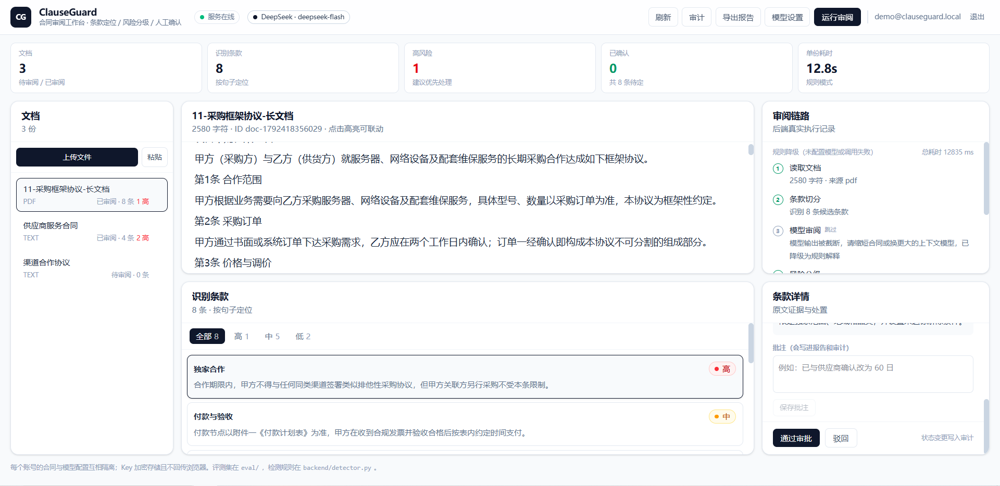
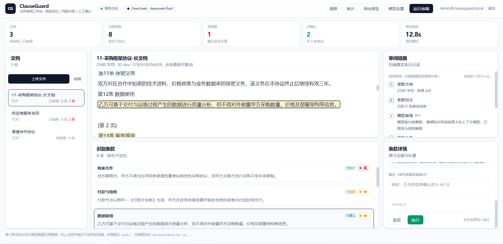
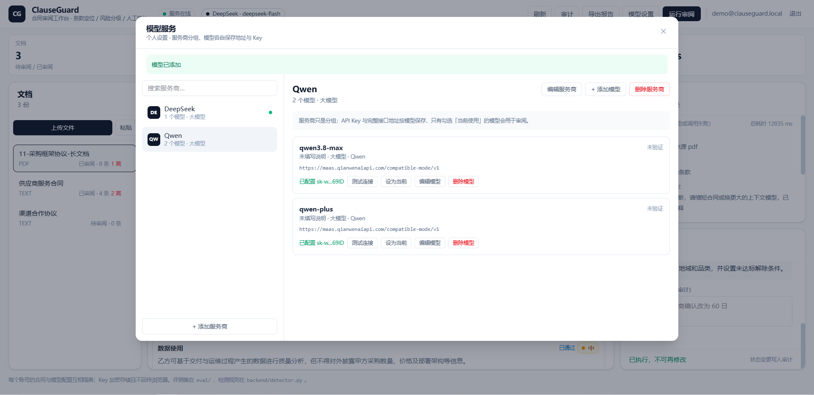

# ClauseGuard · AI 合同审阅工作台

把合同文本变成**可定位、可解释、可追溯**的审阅结果：条款切分 → 风险分级 → 原文证据 → 人工处置与批注 → 导出报告，全链路留审计。

技术栈：FastAPI · SQLite · React 19 · TypeScript · Vite · Tailwind CSS

**在线演示**　https://contract-review-agent-xi3i.onrender.com

> 免费实例，首次访问可能需要 30–60 秒唤醒。演示账号 `demo@clauseguard.local` / `demo1234`（未配置模型，以规则模式运行；配置自己的模型后可看到 AI 生成的风险解释）。

## 界面预览

**主工作台**　左侧文档 · 中间原文高亮 · 右侧条款证据



**审批状态机**　待审批 → 已通过 / 已驳回 → 已执行，服务端强制门禁



**模型配置**　服务商只是分组，每个模型独立保存接口地址与 Key



## 功能

**账号与数据隔离**
- 邮箱或用户名注册登录，密码 PBKDF2-SHA256（60 万次）加盐哈希
- 服务端会话 + httpOnly Cookie，重启不失效，可吊销
- 每个账号的合同、条款、批注、审计完全隔离，越权访问返回 404

**模型配置**
- 不受限于厂商：任何 OpenAI 兼容接口都能接（DeepSeek / Kimi / 通义 / 智谱 / OpenAI / OpenRouter / SiliconFlow / 本地 Ollama）
- 服务商只是分组，每个模型独立保存接口地址与 Key
- Key 用 Fernet 加密落库，接口只回显掩码，永远不回传前端
- 未配置模型时自动降级为规则解释，功能不中断

**合同审阅**
- 导入 TXT / Markdown / Word / PDF；PDF 逐行抽取后会按标点重排成段落
- 8 类条款规则检测（付款、责任、续期、独家、数据、SLA、保密、知识产权）
- 条款按句子边界定位，前后端共用字符偏移量，原文高亮与卡片双向联动
- SSE 流式推送执行步骤，失败自动降级
- 重新审阅保留已采纳状态与批注，不冲掉人工判断

**协作与交付**
- 逐条采纳 / 驳回、批注
- 审计日志：导入、审阅、采纳、驳回、批注、删除
- 导出 Word / Markdown 审阅报告
- 删除为软删除，审计记录保留

**模型调用可观测**
- 每次模型调用（审阅、连接检测）都会记录：模型、prompt/completion token、总 token、耗时、成功或失败原因
- 顶栏「用量」面板按近 7 / 14 / 30 天汇总：调用次数、token 合计、平均与 P95 耗时、失败次数，并按模型分组
- 记录是旁路逻辑：写日志失败只打警告，绝不影响审阅主流程
- 数据按账号隔离，接口 `GET /api/metrics/llm?days=7`

**语义召回（规则补充通道）**
- 针对规则漏检同义表述的问题（如「账期三个月」「到期自动延续」），用向量相似度补一条候选条款
- 合同逐句向量化，与内置的 8 类同义样本库比对；相似度超过阈值、且该句未被规则命中时才补
- 命中结果标注「语义相似：<样本句>」，风险等级沿用类别默认值，仍可人工采纳/驳回
- 默认关闭；在「语义召回」里选择向量模型（需支持 `/embeddings`）并设定阈值（0.60–0.95，默认 0.82）
- 向量结果按 `(模型, 地址, 文本)` 哈希缓存，重复审阅不重复计费；关闭时不产生任何向量调用

## 快速开始

需要 Python 3.10+、Node.js 18+。

```powershell
# 后端（首次会自动建虚拟环境并装依赖）
.\run_local.ps1
# 打开 http://127.0.0.1:8103
```

前端已提交构建配置，首次需要安装依赖并构建：

```bash
cd web
npm install
npm run build
```

开发模式下可分离运行（前端热更新）：

```bash
# 终端 1
.\run_local.ps1
# 终端 2
cd web && npm run dev   # http://127.0.0.1:5173，/api 代理到 8103
```

演示账号：`demo@clauseguard.local` / `demo1234`（首次启动自动创建，含 3 份示例合同）。

## 目录结构

```
backend/     接口、规则检测、模型调用、文件解析、安全、用量统计（llm_stats.py）
web/         React 前端（构建产物由后端同源托管）
docs/        设计与使用文档（12 篇）
eval/        条款检测评测集与指标
tests/       接口、租户隔离、解析、用量统计、冒烟
```

## 三个关键设计

1. **检测用规则，生成用模型**
   同一份合同必须每次审出同样结果，才能回归与评测；模型只写风险解释与修改建议，且必须绑定已有原文切片。

2. **输出粒度是句子**
   命中词四周取固定窗口会让高亮与条款错位；统一到句子边界后，`text.slice(start, end)` 与后端 `original` 严格相等。

3. **前后端共用一套坐标**
   条款偏移量由后端计算、前端直接切片渲染，不做二次映射。

## 评测

```bash
python eval/run_eval.py
```

8 例冒烟集（含硬负样本）：

| 版本 | Precision | Recall | F1 |
| --- | --- | --- | --- |
| v1 | 0.800 | 0.857 | 0.828 |
| v2 | 1.000 | 0.929 | 0.963 |

唯一漏检是同义改写（"单方解除且无需补偿"，无关键词），即规则天花板，也是下一步接语义召回的理由。
**8 例不代表真实世界水平**，扩到 50 例并留 holdout 才有说服力。

## 测试

```bash
python -m unittest discover -s tests -t .
python tests/smoke.py          # 需先启动服务
cd web && npx tsc --noEmit && npm test
```

当前：73 项后端测试（含 5 项用量统计、17 项语义召回、6 项历史案例）、9 项前端单测、14 项真实 HTTP 冒烟全部通过。

## 安全

- 密码 PBKDF2（60 万次）+ 每用户随机盐；策略要求 ≥8 位且含大小写字母、数字、符号中至少三类
- 会话只存令牌 SHA-256，httpOnly + SameSite=Lax
- 模型 Key Fernet 加密，接口只返回掩码
- 用户填的接口地址由服务端请求，校验后拒绝内网地址、强制 https、不跟随跳转（防 SSRF）
- 登录失败限流：同账号 10 分钟 8 次

## 文档

全部在 `docs/`，入口 [docs/README.md](docs/README.md)：

- 上手：快速开始 · 操作手册（12 步全流程走查）
- 理解：功能清单 · 架构设计 · 数据模型 · 安全设计
- 使用：API 接口 · 部署指南 · 常见问题
- 工程：测试与评测 · 开发规范 · 变更记录

## 已知限制

- SQLite 单实例，多副本部署需换 Postgres
- 扫描版 PDF 无 OCR；PDF 表格的列结构会塌缩成一行
- 条款检测以规则为主：未开启语义召回时，同义改写仍会漏检
- 语义召回的样本库是人工维护的 8 类锚点，覆盖不到的表达仍会漏
- 长文档未做虚拟滚动
- 无团队空间，数据严格按个人隔离

## 免责声明

本项目用于技术演示，输出结果不构成法律意见。正式合同审阅请由专业法务人员完成。
